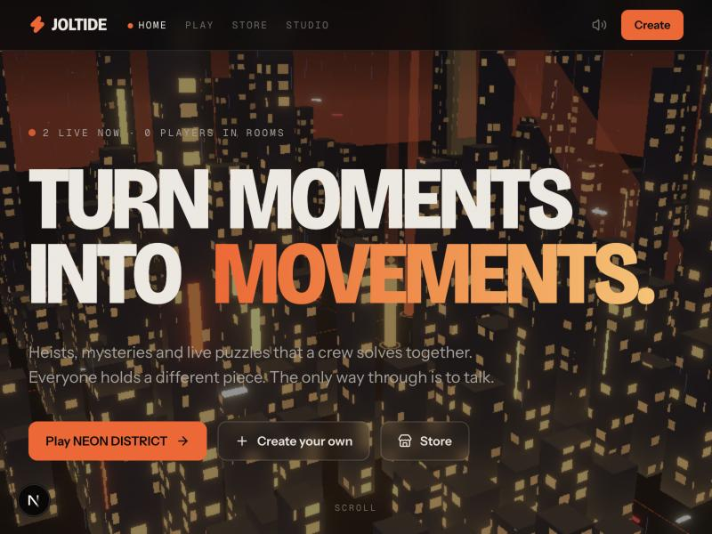
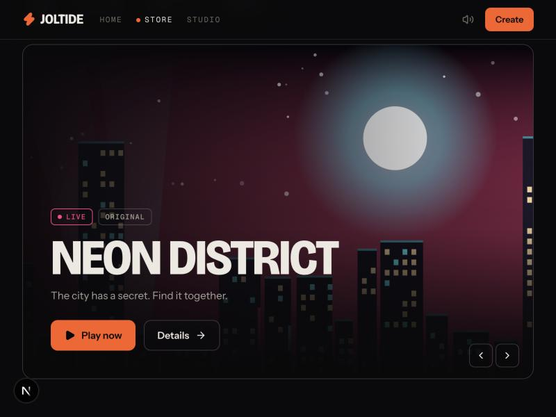
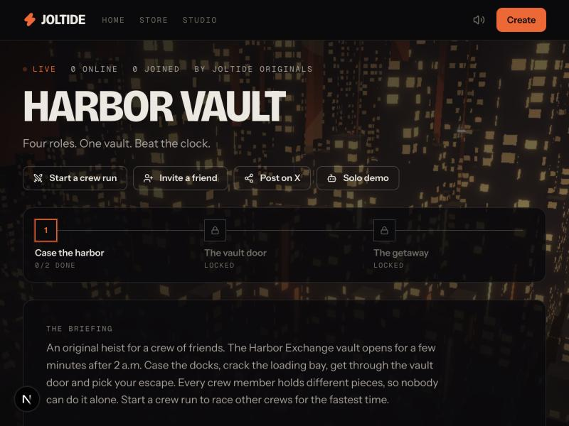
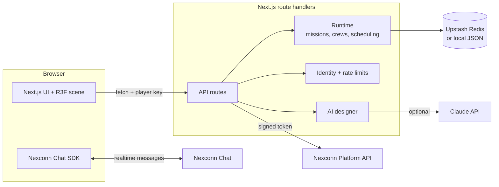

<div align="center">

# ⚡ JOLTIDE

### Turn moments into movements.

**Interactive, multiplayer experiences for communities. Heists, mysteries and live events that a crew of friends solves together, in real time.**

[](https://nextjs.org)
[](https://react.dev)
[](https://www.typescriptlang.org)
[](https://r3f.docs.pmnd.rs)
[](https://www.nexconn.com)
[](#testing)

*Built for the **Nexconn Build Challenge 2026** · Social & Community track*

<br />



</div>

---

## What is it?

Chat apps are where communities *talk*. JOLTIDE is where they *do something together*.

A creator publishes an **experience**: a crew heist, a city-wide mystery, a live puzzle drop. Friends join, get **different roles with different pieces of the answer**, and have to communicate to win. Nobody can solve it alone, so every run pulls people into the chat, into invites, and into the community.

| For players | For creators | For communities |
| --- | --- | --- |
| Join a crew run in one click | Describe a world, and AI drafts the experience | Scheduled launches create appointment moments |
| Four roles, each holding unique fragments | Studio to edit, publish and schedule | Leaderboards and shareable proof badges |
| Race the clock and other crews | Dashboard with joins, completions and funnel | Marketplace to remix and re-list templates |

<div align="center">


</div>

## Features

- **Crew runs.** Lobby, roles (Hacker, Driver, Inside Man, Lookout), heist clock, and a leaderboard. Fragments are dealt round-robin so the team must share to progress.
- **Staged missions.** Answer, shard and vote missions. Stages unlock once a threshold of players clears them.
- **Solo sandbox.** Try any experience alone against a bot teammate ("Echo") before inviting friends.
- **Scheduled launches.** Experiences can open at a set time. The server enforces it, so there are no early peeks.
- **AI world designer.** Describe a vibe, and Claude drafts missions, palette and a city layout. A built-in generator is the fallback when no API key is set.
- **3D worlds.** A custom GLSL window-grid city in React Three Fiber, with reflections, rain, traffic and holograms. The palette morphs per experience, and quality adapts to the GPU.
- **Marketplace.** Browse, clone and remix experiences.
- **Proof badges.** HMAC-signed completion badges with a public verification page.
- **Streaming overlay.** A transparent `/overlay/[id]` page for OBS, so streamers can show a live run.
- **Creator tools.** Studio, analytics dashboard, waitlist and announcements.

## How it uses Nexconn

Realtime is not bolted on; it is the game loop.

| Nexconn feature | Used for |
| --- | --- |
| **Group channel** | The private team room for each crew run |
| **Open channel** | The public live room for each experience |
| **Custom messages** `JT:Clue`, `JT:Event`, `JT:React` | Clue sharing, game events and live reactions inside chat |
| **Platform API** | Server-signed user tokens and channel creation |
| **Chat SDK (Web)** | `@nexconn/engine` and `@nexconn/chat` on the client |

## Architecture



The runtime is **server-authoritative**. The browser never decides whether an answer is right, a stage is unlocked or a run has started.

## Quick start

```bash
git clone https://github.com/Shikhyy/Joltide.git
cd Joltide
npm install
cp .env.example .env.local   # then fill in your own keys
npm run dev                  # http://localhost:3000
```

The app runs without any keys (local storage, built-in generator), but live chat needs Nexconn credentials.

```bash
npm run verify:nexconn       # checks your Nexconn key and secret against the API
```

### Environment

| Variable | Required | Purpose |
| --- | --- | --- |
| `NEXT_PUBLIC_NEXCONN_APP_KEY` | for chat | Public App Key from the Nexconn console |
| `NEXCONN_APP_SECRET` | for chat | **Server-only.** Signs Platform API calls |
| `NEXT_PUBLIC_NEXCONN_AREA` | for chat | Data center: `SG` or `NA` |
| `NEXCONN_API_HOST` | for chat | API host matching your data center |
| `IDENTITY_SECRET` | production | Signs player keys. Use a long, stable random value |
| `ANTHROPIC_API_KEY` | optional | Enables the Claude world designer |
| `UPSTASH_REDIS_REST_URL` / `_TOKEN` | production | Durable persistence (local JSON is used in dev) |

Deployment notes are in [docs/DEPLOY.md](docs/DEPLOY.md).

## Testing

```bash
npm test         # 28 tests: runtime, crews, identity, features
npm run lint
npx tsc --noEmit
npm run build
```

## Project structure

```text
src/
  app/            routes: /, /market, /studio, /e/[id], /proof, /badge/[token], /overlay/[id]
    api/          route handlers (experiences, crew, identity, generate, ...)
  components/     UI, 3D scene, studio, dashboard, chat panel
  lib/            runtime, nexconn-server, chat, ai, templates, identity, badge, store
tests/            vitest suites with an in-memory store stub
scripts/          verify-nexconn.mjs
docs/             deployment guide and screenshots
```

## Security

- Player identity is a server-minted id plus an HMAC key, sent as `x-player-key`. Public ids alone cannot be used to impersonate anyone.
- The Nexconn App Secret never reaches the browser; token minting happens server-side.
- State-changing routes are validated with zod and rate limited.
- Secrets live only in environment variables. `.env*` is git-ignored except `.env.example`.

## Honest limitations

- The Claude-powered designer has been exercised only through its fallback path in testing.
- Sound design and 3D performance on low-end GPUs have not been tuned across many devices.
- Persistence in production relies on Upstash Redis, which has not been load-tested.
- Marketplace payments and on-chain rewards are out of scope for this build.
